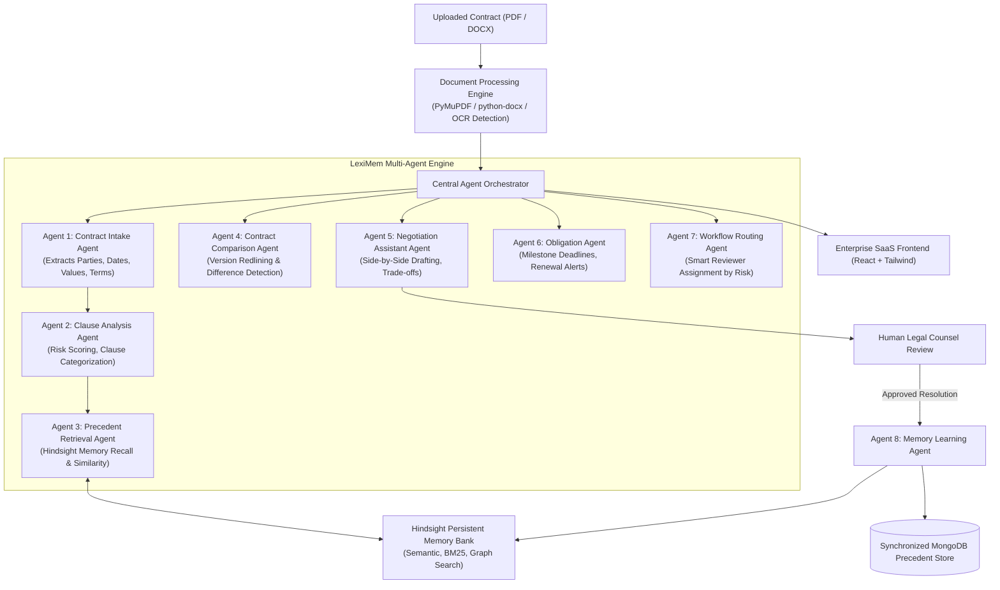

# LexiMem — System Architecture & Multi-Agent Design

## 1. Executive Summary

**LexiMem** is an enterprise-grade AI Contract Lifecycle and Precedent Intelligence platform. Unlike conventional contract lifecycle management (CLM) tools that treat artificial intelligence as a static summarizer or simple chatbot, LexiMem introduces an autonomous **Precedent Memory Engine** powered by **Hindsight**.

The system dynamically learns from lawyer-confirmed decisions, accepted counterproposals, and rejected clauses across the enterprise. When a new contract is uploaded, LexiMem recalls matching organizational precedents, redlines material differences, and provides evidence-backed recommendations linked to authoritative source contracts.

---

## 2. Multi-Agent System Topology

LexiMem deploys eight specialized AI agents coordinated by an **Agent Orchestrator**:

---

## 3. The 8 Modular Agents

### Agent 1 — Contract Intake Agent
- **Purpose**: Parses raw extracted text without fabricating missing information.
- **Rules**: Identifies contract title, type, parties, counterparty, effective date, expiry date, governing law, payment terms, and explicitly flags missing fields in a structured missingFields array.
- **Inference**: Groq Llama 3.3 with strict JSON schema and deterministic legal fallback.

### Agent 2 — Clause Analysis Agent
- **Purpose**: Deconstructs contract text into individual categorized clauses (Liability, Indemnification, Confidentiality, Termination, Governing Law, IP Ownership, etc.).
- **Risk Assessment**: Detects uncapped liabilities, one-sided indemnification, aggressive liquidated damages, and auto-renewal traps.
- **Scoring**: Computes overall contract risk score (0-100) and assigns severity levels (`Critical`, `High`, `Medium`, `Low`, `Informational`).

### Agent 3 — Precedent Retrieval Agent
- **Purpose**: Queries Hindsight persistent memory to find historical confirmed decisions for each clause.
- **Parallel Search**: Combines semantic embedding similarity, keyword matching (BM25), and graph topology.
- **Safety Rule**: Never treats raw semantic similarity as legal equivalence. Identifies nuances and wording differences between current text and approved precedents.

### Agent 4 — Contract Comparison Agent
- **Purpose**: Evaluates revisions between contract versions (e.g. v1 vs v2).
- **Difference Tracking**: Tags added, removed, and modified clauses, and flags whether a counterparty revision altered a previously approved precedent.

### Agent 5 — Negotiation Assistant Agent
- **Purpose**: Side-by-side workspace comparing:
  $$\text{Original Clause} \quad\longleftrightarrow\quad \text{AI Suggestion} \quad\longleftrightarrow\quad \text{Approved Precedent}$$
- **Output**: Generates counterproposal drafts with explicit advantages (pros), trade-offs (cons), and negotiation talking points.

### Agent 6 — Obligation Agent
- **Purpose**: Extracts operational and financial commitments from contract text.
- **Renewal Alert Engine**: Distinguishes contract expiration dates from advance written non-renewal notice deadlines (90, 60, 30, and 7 days).

### Agent 7 — Workflow Agent
- **Purpose**: Routes contracts to reviewers based on risk score, contract value, and organizational role.
- **State Machine**: Governs transitions through Draft $\rightarrow$ Submitted $\rightarrow$ Under Review $\rightarrow$ Changes Requested $\rightarrow$ Negotiation $\rightarrow$ Pending Approval $\rightarrow$ Approved $\rightarrow$ Active $\rightarrow$ Expired $\rightarrow$ Archived.

### Agent 8 — Memory Learning Agent
- **Core Safety Constraint**: Unverified AI suggestions are **never** committed to memory as legal precedents.
- **Provenance**: When a human lawyer approves or modifies a clause resolution, Agent 8 retains the decision in Hindsight with complete provenance metadata (contract ID, jurisdiction, approver ID, and decision rationale).

---

## 4. Hindsight Persistent Memory Architecture

LexiMem integrates directly with **Hindsight** (`vectorize-io/hindsight`):

1. **`retain()`**:
   - Commits confirmed legal precedents into memory banks partitioned by organization (`leximem-<orgId>`).
   - Extracts multidimensional facts, temporal attributes, and entities.
2. **`recall()`**:
   - Executes 4-way parallel search strategy combining semantic similarity, BM25 keyword matching, entity graph traversal, and temporal reasoning.
3. **Dual Synchronization**:
   - Every retained memory is mirrored in MongoDB's `Precedents` collection.
   - If Hindsight Cloud or self-hosted Docker is temporarily unreachable, LexiMem automatically falls back to local synchronized precedent matching, guaranteeing zero disruption.

---

## 5. Security & Isolation

- **Role-Based Access Control (RBAC)**: Admin, Lawyer, Business User with backend permission enforcement.
- **Organization Isolation**: Every database query is scoped to the user's `organizationId`.
- **Document Preservation**: Uploaded original files are immutable and stored securely in `server/uploads/`.
- **Immutable Audit Trail**: All uploads, downloads, AI inferences, precedent approvals, and workflow state transitions are permanently recorded in `AuditLog`.
